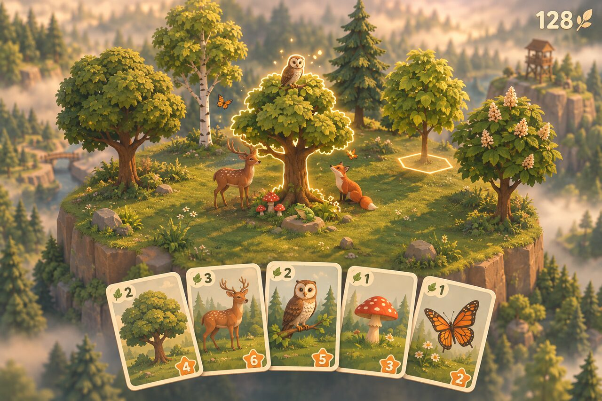
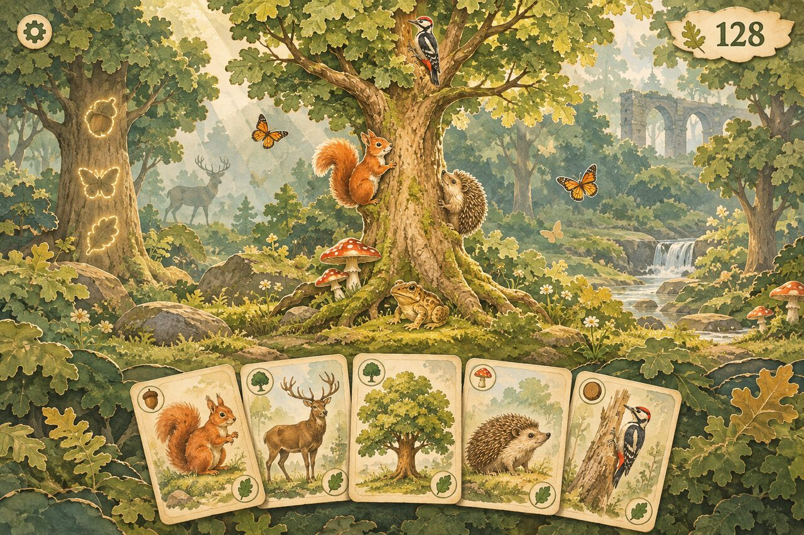
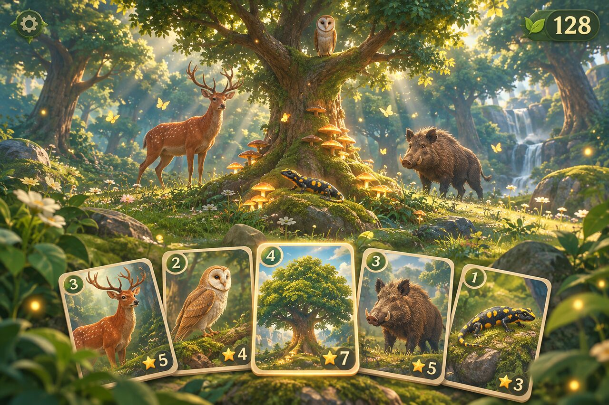

# 작은 숲 (Little Grove) 게임 기획서 v1

> **한 줄 소개:** 벌목으로 비어 버린 산자락에 나무를 심고, 카드를 낼 때마다 그 나무에 새·곤충·짐승이 **실제로 날아와 붙는** 2.5D 숲 가꾸기 카드 로그라이트. 봄에서 겨울까지 숲이 자라고, 계절 끝에 숲 전체가 점수로 터진다.
> **키워드:** 숲 카드 퍼즐 · 나무 4방향에 이웃 붙이기 · 살아 움직이는 3D 디오라마 · 계절 바람 시계 · 한 해 더

원작: 보드게임 **Forest Shuffle**(Kosch, Lookout Games)의 핵심 규칙(나무 카드 + 위·아래·왼쪽·오른쪽으로 붙는 반쪽 카드, 손패로 비용 내기, 공터, 겨울 카드 3장으로 끝)을 1인 로그라이트로 옮긴다. 카드 이름·효과 문구·점수표·그림은 원작 것을 쓰지 않고 새로 만든다(실제 생물 이름은 쓴다).

공통 기준(로그라이트 구조, 콘솔식 큰 화면, 단계별 안내)은 [`docs/game-guide.md`](../../../docs/game-guide.md)를 따른다. 이 문서는 이 게임에서 정하는 것만 적는다.



---

## 1. 개요

### 1.1 콘셉트

할머니가 남긴 산자락은 벌목꾼이 지나간 뒤 그루터기만 남았다. 손에 쥔 건 씨앗 주머니 하나와 숲지기 수첩. 1년 안에 숲을 되살려 「보호림」 지정을 받아야 땅을 지킬 수 있다. 나무를 심으면 이웃이 찾아온다. 이웃이 많고 서로 잘 어울릴수록 숲은 살아난다.

### 1.2 기본 사양

| 항목 | 방향 |
|---|---|
| 장르 | 1인 숲 카드 퍼즐 로그라이트. 한 판(1년 = 4계절) 25~35분 |
| 전체 플레이 | 첫 보호림까지 4~6시간, 도감·해금 전부 15시간 이상, 그 뒤 숲 등급 8단계·끝없는 해·오늘의 숲 |
| 플랫폼 | PC / Steam(Steam Deck), 웹 미리보기. 나중에 모바일 |
| 그래픽 | **2.5D: 3D 디오라마를 비스듬히 내려다보는 고정 카메라**(6장). 떠 있는 숲 섬 위에 나무와 동물이 3D 모델로 서고, 손패 카드는 2D UI. 카드 그림은 같은 3D 모델을 같은 조명으로 구워 만든다 |
| 엔진 | Godot 4.7 3D. Steam은 Forward+, 웹은 Compatibility 렌더러(6.5) |
| 조작 | 마우스·터치·패드: 카드를 끌어 숲의 빛나는 자리에 놓기, 또는 카드 고르기 → 자리 고르기 |
| 언어 | 한국어, 영어 |

### 1.3 핵심 재미

1. **카드가 숲이 된다:** 사슴 카드를 참나무 왼쪽에 놓으면 숲 가장자리에서 사슴이 걸어와 그 나무 왼쪽에 선다. 올빼미는 날아와 꼭대기 가지에 앉고, 버섯은 뿌리 옆에서 솟는다. 내 숲이 한 장씩 실제로 자란다.
2. **반쪽 고르기:** 한 장에 이웃 둘(위/아래 또는 왼/오른)이 있고 하나만 쓴다. 나머지 반은 나무 밑으로 숨어 사라진다. "어느 쪽을 살릴까, 어느 나무 어느 쪽에 붙일까"가 매 턴 고민이다.
3. **비용 = 손패:** 카드를 내려면 다른 카드를 공터로 버려야 한다. 버린 카드는 공터에 앞면으로 남아 다음 턴에 주워 올 수 있다. 같은 나무 색으로만 내면 보너스.
4. **계절 끝 폭발:** 계절 바람 카드 3장째가 뜨면 계절이 끝나고, 카메라가 숲을 한 바퀴 돌며 나무·이웃마다 점수가 뜬다. 숲 정령(유물)의 배수가 마지막에 곱해진다.
5. **숲이 남는다:** 계절이 바뀌어도 숲은 그대로다. 봄 연두 → 여름 짙은 초록 → 가을 단풍 → 겨울 눈으로 같은 숲의 색이 바뀌고, 다음 계절은 그 위에서 이어 짓는다.

### 1.4 비슷한 게임과 차별점

| 게임 | 공통점 | 이 게임의 차이 |
|---|---|---|
| Forest Shuffle (원작 보드게임) | 나무 + 4방향 반쪽 카드, 손패 비용, 공터, 겨울 카드 | 1인 로그라이트. 숲이 **3D로 실제 자란다**. 4계절 목표 점수, 계절 사건, 숲 정령, 씨앗 주머니 덱빌딩 |
| Wingspan (디지털판) | 동물 카드를 서식지에 놓기, 실사풍 생물 | 놓은 카드가 3D 생물로 숲에 산다. 대전이 아니라 런 |
| Dorfromantik | 아늑한 디오라마, 놓을수록 풍경이 자람 | 타일 대신 카드 조합 점수, 이웃 사이 시너지 |
| Balatro | 기본 점수 × 배수, 유물 빌드 | 숫자 대신 생태계 조합(나비 세트, 박쥐 3종, 같은 나무 4그루) |

---

## 2. 한 판의 흐름

```
런 = 1년 = 봄 → 여름 → 가을 → 겨울
계절 1개 = 씨앗 주머니를 섞은 계절 덱 + 계절 바람 3장 → 3장째가 뜨면 계절 끝
계절 끝 = 숲 전체 점수 세기 → 목표 점수를 넘으면 다음 계절
계절 사이 = 숲지기 오두막(보상 3장 중 1장, 상점)
겨울 끝 목표(보호림 심사)를 넘기면 완주 → 「다음 해」로 계속(끝없는 해)
```

- **숲은 런 내내 남는다.** 계절이 바뀌어도 심은 나무와 이웃은 그대로고, 계절 점수는 그때까지의 숲 전체로 센다.
- **씨앗 주머니 = 덱.** 계절마다 주머니 전체를 새로 섞어 계절 덱을 만든다. 숲에 낸 카드도 주머니에서 빠지지 않는다(그 종을 다시 부를 수 있다).
- 계절 덱 아래 1/3에 **계절 바람 3장**을 섞는다. 뽑히면 하늘 위 바람 칸이 하나 차고(하늘색이 다음 계절 쪽으로 바뀜) 대신 1장을 더 뽑는다. 3장째가 뜨면 그 즉시 계절이 끝난다(턴을 마치지 못한다).
- 목표 점수를 못 넘기면 런이 끝난다. 실패 연출: 벌목꾼 트럭 소리, 숲이 회색으로 바래며 나무가 하나씩 쓰러진다. 무엇이 모자랐는지(점수 부족분, 가장 약했던 종류) 한 장면으로 보여 준다.

### 2.1 차례 (원작 규칙 바탕)

차례마다 둘 중 하나를 한다.

- **A. 2장 가져오기:** 1장씩 2번. 매번 계절 덱 맨 위(뒷면) 또는 공터의 앞면 카드 중 고른다. 손패 한도 10장.
- **B. 1장 내기:** 손패에서 다른 카드를 비용만큼 공터로 버리고 카드를 숲에 낸다.
  - **나무 카드:** 섬의 빈 땅 자리 중 하나를 골라 심는다. 나무를 심으면 계절 덱 맨 위 1장이 공터로 떨어진다(바람에 날린 씨앗).
  - **묘목:** 아무 카드나 뒷면으로 묘목으로 심을 수 있다. 4방향 자리는 있지만 어느 나무 종도 아니다.
  - **이웃 카드(반쪽 카드):** 한쪽 반을 골라 그 방향 자리가 빈 나무에 붙인다. 위 반쪽은 나무 위, 아래 반쪽은 나무 아래, 왼/오른 반쪽은 나무 왼/오른쪽에만 붙는다. 숨은 반쪽은 점수·효과에 쓰이지 않는다.
  - 낸 뒤 **효과 → 보너스** 순서로 쓴다. 보너스는 비용으로 버린 카드가 모두 낸 카드와 같은 나무 색일 때만 쓴다.
- 차례 끝에 공터가 10장 이상이면 **바람이 공터를 쓸어 간다**(모두 버림 더미로).

### 2.2 계절 목표와 사건 (4-3에서 봇 2000판으로 조정)

| 계절 | 봄 | 여름 | 가을 | 겨울(보호림 심사) |
|---|---|---|---|---|
| 목표 점수 | 35 | 150 | 400 | 800 |
| 사건 (8종 중 1, 미리 보임, 4-2에서 8종으로) | 늦서리, 황사, 꽃샘바람, 산비둘기 떼 | 가뭄, 장마, 매미 떼, 등산객 | 산불 주의보, 솔방울 흉년, 벌목꾼 측량, 태풍 | 혹한, 폭설, 긴 밤, 먹이 부족 |

사건은 계절 하나 동안 규칙 하나를 비튼다(공통 가이드의 보스 역할). 예:

| 사건 | 규칙 |
|---|---|
| 늦서리 | 아래 자리 이웃은 이번 계절 점수 절반 |
| 가뭄 | 공터가 7장이면 쓸려 간다 |
| 장마 | 양서류·버섯 점수 ×2, 나비·박쥐 0점 |
| 벌목꾼 측량 | 이웃이 하나도 없는 나무는 계절 끝에 베어진다 |
| 태풍 | 계절 바람이 4장 |
| 폭설 | 손패 한도 7장 |

1-3 구현(16종, `scripts/rules/events.gd`): 봄 늦서리(아래 ×½)·황사(새 ×½)·꽃샘바람(나비 0)·산비둘기 떼(공터 8장) / 여름 가뭄(공터 7장)·장마·매미 떼(곤충 ×2, 손패 8)·등산객(발굽 ×½) / 가을 산불 주의보(손패 8)·솔방울 흉년(솔방울 0)·벌목꾼 측량·태풍 / 겨울 혹한(위 ×½)·폭설·긴 밤(박쥐 ×2, 나비 0)·먹이 부족(발바닥 ×½).

### 2.3 숲지기 오두막 (계절 사이)

- **보상 3장 중 1장:** 새 종 카드 2장 묶음, 숲 정령 1개, 또는 주머니에서 카드 2장 빼기.
- **솔방울(돈)로 사기:** 목표를 넘긴 점수 10점당 1, 남은 계절 덱 4장당 1 솔방울를 받는다(1-3 초기값). 값: 새 카드 2장 3, 정령 6, 카드 2장 빼기 2, 땅 2칸 4. 종 카드, 숲 정령, 카드 꾸미기(이슬: 점수 +2, 금빛 잎: 어느 나무 색으로도 셈 등)를 산다.
- **땅 넓히기:** 섬 가장자리에 새 땅 자리 2칸을 연다(시작 9칸 → 최대 25칸). 연출: 안개가 걷히며 섬이 커진다.

---

## 3. 카드

### 3.1 나무 8종 (시작 주머니 각 1~3장)

이름은 실제 나무, 점수 규칙은 새로 짠다(원작과 숫자·조건을 다르게 한다).

| 나무 | 비용 | 점수 (초안) | 3D 특징 |
|---|---|---|---|
| 참나무 | 2 | 숲에 나무 종류가 6가지 이상이면 8 | 넓고 둥근 수관 |
| 자작나무 | 0 | 1. 심으면 1장 뽑기 | 흰 줄기 |
| 소나무 | 1 | 이 나무에 붙은 이웃 1마리마다 2 | 굽은 줄기, 바늘잎 |
| 전나무 | 2 | 6. 같은 색 보너스: 굴에 1장 | 곧고 뾰족함 |
| 단풍나무 | 2 | 가을·겨울에 세면 7, 아니면 3 | 가을에 붉게 변함 |
| 밤나무 | 1 | 세트: 1/2/3/4/5그루 → 1/4/8/14/20 | 꽃 이삭, 가을 밤송이 |
| 피나무 | 1 | 숲에서 가장 많은(동률 포함) 나무 종이면 4, 아니면 1 | 하트 모양 잎 |
| 너도밤나무 | 1 | 3그루 이상이면 그루당 5 | 매끈한 회색 줄기 |

### 3.2 이웃 (반쪽 카드)

종류 아이콘 11개: 나무, 새, 나비, 곤충, 박쥐, 사슴, 발굽 짐승, 발바닥 짐승, 양서류, 버섯, 풀꽃.

| 자리 | 주로 오는 이웃 | 3D 위치 |
|---|---|---|
| 위 | 새, 나비, 박쥐(일부), 다람쥐 | 수관 꼭대기·가지 끝 |
| 아래 | 버섯, 풀꽃, 양서류, 곤충 | 뿌리 둘레 땅 |
| 왼/오른 | 사슴, 발굽·발바닥 짐승, 박쥐, 나비(일부) | 줄기 양옆 땅·줄기 위 |

점수 패턴(원작의 재미 구조는 유지, 문구·숫자는 새로):

| 패턴 | 예 (초안) |
|---|---|
| 세트 수집 | 나비: 서로 다른 나비 1~6종 → 0/3/7/12/20/32 |
| 종류 수 조건 | 박쥐: 서로 다른 박쥐 3종 이상이면 마리당 5 |
| 다른 종류 세기 | 고슴도치: 숲의 나비 1마리마다 2 · 오소리: 아래 자리 이웃 1마리마다 1 |
| 같은 나무 조건 | 동고비: 너도밤나무에 붙으면 6 · 하늘다람쥐: 같은 나무에 박쥐가 있으면 7 |
| 꽉 찬 나무 | 담비: 4방향이 다 찬 나무 1그루마다 4 |
| 함께 살기 | 산토끼: 한 자리에 몇 마리든 겹칠 수 있고 산토끼 1마리마다 1 |
| 효과형 | 다람쥐: 낸 뒤 공터에서 1장 줍기 · 딱따구리: 한 차례 더 · 너구리: 손패를 원하는 만큼 굴에 넣고 같은 수 뽑기 |
| 버섯(지속 효과, 점수 0) | 꾀꼬리버섯: 앞으로 나무 왼쪽에 낼 때마다 1장 뽑기 · 노루궁뎅이: 앞으로 새를 낼 때마다 솔방울 1 |

시작 이웃 14종 (1-2 구현, 규칙 말은 `scripts/rules/score.gd`):

| 종 | 자리 | 비용 | 점수 | 효과 / 같은 색 보너스 |
|---|---|---|---|---|
| 올빼미 | 위 | 2 | 발바닥 짐승 1마리마다 1 | 보너스 1장 뽑기 |
| 금화조 | 위 | 1 | 같은 나무에 나비가 있으면 5, 아니면 2 | 보너스 공터 1장 줍기 |
| 박쥐 | 위 | 1 | 서로 다른 박쥐 3종 이상이면 마리당 5, 아니면 1 | 보너스 1장 뽑기 |
| 나비 | 위 | 0 | 숲의 서로 다른 나비 1~5종 → 3/7/12/20/32 (나비 종류 전체에 한 번) | |
| 벌 | 아래 | 1 | 풀꽃 1마리마다 2 | 효과 공터 1장 줍기 |
| 버섯 | 아래 | 2 | 0 | 지속: 앞으로 나무 왼쪽에 낼 때마다 1장 뽑기 |
| 풀꽃 | 아래 | 0 | 2 | |
| 두더지 | 아래 | 2 | 아래 자리 이웃 1마리마다 1 | 효과 굴에 2장 |
| 도롱뇽 | 아래 | 1 | 소나무·전나무에 붙으면 5, 아니면 2 | 보너스 2장 뽑기 |
| 여우 | 옆 | 2 | 산토끼 1마리마다 2 | 효과 1장 뽑기 |
| 산양 | 옆 | 3 | 4방향이 다 찬 나무 1그루마다 4 | 보너스 2장 뽑기 |
| 멧돼지 | 옆 | 2 | 참나무·밤나무·너도밤나무에 붙으면 7, 아니면 2 | 효과 굴에 1장 |
| 산토끼 | 옆 | 0 | 산토끼 1마리마다 1, 한 자리에 5마리까지 겹침 | |
| 마멋 | 옆 | 1 | 발바닥 짐승 종 가짓수마다 2 | 효과 공터 1장 줍기 |


3-1에서 더한 26종(보상·가게로만 들어온다, `Cards.SPECIES`): 참수리(8)·오색딱따구리(나무 1그루당 1)·어치(참나무당 3)·레서판다(단풍·피나무 5) / 긴귀박쥐·관박쥐(박쥐 세트) / 호랑나비·모르포나비·공작나비·배추흰나비(나비 세트) / 꼬리치레도롱뇽(양서류당 1)·불도롱뇽(4, 굴 1) / 꾀꼬리버섯(지속: 위 자리에 낼 때 1장)·광대버섯(지속: 나무 심을 때 1장) / 제비꽃(같은 나무에 나비 4)·고사리(소나무·전나무 4) / 등줄쥐(버섯당 2)·오소리(아래 자리당 2)·늑대(사슴당 4)·반달가슴곰(굴 1장당 1)·수달(양서류당 2) / 노루(나무 종류당 1)·붉은사슴(풀꽃당 2) / 청둥오리(아래, 3)·메추라기(옆, 새당 1)·따오기(옆, 소나무 8).
3D 모델은 Gobkit CC0 동물 10종을 더했고, 같은 모델의 색을 바꿔(`Dweller.KINDS.tint`) 여러 종을 만든다.

- **굴:** 나무 구멍 저장소. 효과로 카드를 넣고, 굴의 카드 1장 = 1점.
- 시작 주머니 36장(나무 12, 이웃 24). 종 카드는 MVP 40종 → 출시 90종.

### 3.3 숲 정령 (유물, 5칸)

규칙을 비틀어 빌드를 만든다. 예:

| 정령 | 효과 |
|---|---|
| 반딧불 정령 | 나비·곤충이 5마리 이상이면 계절 끝 점수 ×1.5 |
| 늙은 부엉이 | 새 1종류마다 배수 +0.1 |
| 이끼 할멈 (3-1) | 묘목도 아무 나무 종 하나로 셈 |
| 바람 아이 | 계절 바람이 처음 뜰 때 1장 대신 3장 뽑기 |
| 겨울잠 곰 | 겨울 사건 효과 무시 |
| 솔방울 다람쥐 | 굴의 카드 1장 = 2점 |
| 두 갈래 길 (3-1) | 이웃 카드의 숨은 반쪽도 점수 절반 |

3-1 구현: 30종(`scripts/rules/spirits.gd`). 종류 수·자리 수·나무 종류·꽉 찬 나무·묘목·굴·계절 조건 배수와, 손패·공터 한도·시작 카드·솔방울·첫 바람 규칙형. 이끼 할멈은 「묘목마다 배수 +0.1」로 바꿨고, 두 갈래 길(숨은 반쪽 점수)은 4-2로 미룬다.
카드 꾸미기(가게, 솔방울 3): 이슬 = 그 카드 점수 +2, 금빛 잎 = 어느 나무 색으로도 셈(보너스 조건).

- 계절 끝 점수 = (나무·이웃 점수 합 + 굴) × 정령 배수. 배수는 마지막에 큰 연출로 곱한다.

---

## 4. 오래 하기 (전체 플레이 5시간 이상)

| 요소 | 내용 | 대략 시간 |
|---|---|---|
| 첫 보호림 | 4계절 완주. 보통 4~7번 시도 | 4~6시간 |
| 숲지기 8명 | 시작 주머니와 고유 능력이 다름(새 박사: 새 카드 많음 / 버섯 할아버지: 버섯 지속 효과 2배 등). 처음엔 1명, 해금하며 늘어난다 | 숲지기마다 1~2시간 |
| 숲 도감 | 처음 숲에 들인 종이 기록된다. 3D 모델을 돌려 보고, 실제 생태 한 줄 설명. "박쥐 4종 한 숲에" 같은 과제로 새 종·정령이 풀린다 | 15시간 이상 |
| 숲 등급 1~8 | 완주할 때마다 하나씩. 목표 상승, 사건 2개, 바람 카드 위로 등 누적 | 25시간 이상 |
| 끝없는 해 | 2년째 봄부터 계속. 숲은 그대로, 목표만 오른다 | 끝없음 |
| 오늘의 숲 | 날마다 같은 seed, 점수 비교 | 매일 |
| 내 숲 앨범 | 런이 끝나면 숲을 360° 돌려 보고 사진으로 남긴다. 앨범에서 지난 숲들을 다시 본다 | — |

4-1 구현: 숲지기 8명(`Keepers.ALL`)은 시작 주머니에 이웃 카드 3~4장을 더하고, 정령 하나를 처음부터 데리고 시작한다. 이 정령은 자리 5칸을 차지하지 않고 `Run.owned()`로 셈한다. 솔방울 상인만 솔방울 8개로 시작한다. 할머니 수첩은 처음부터 열려 있다. 나머지는 해 수, 완주 수, 도감 수로 열린다. 숲 등급 0~8(`Keepers.GRADES`)은 쌓인다. 목표는 ×1.1/×1.2/×1.35, 공터 −1, 손패 −1, 솔방울 ×0.75/×0.5, 겨울 바람 −1이다. 완주한 가장 높은 등급 + 1까지 고를 수 있다. 앨범은 런 끝 화면이 글자를 숨기고 숲을 480×270으로 찍어 `user://album`에 최근 24장까지 남긴다.

4-2 구현: 이웃은 90종(+50: 까치·소쩍새·하늘다람쥐·사슴벌레·표고·산삼·청개구리·원앙·삵·호랑이·고라니·두루미 등)이다. 새 3D 모델은 아직 없어서 기존 CC0 모델의 색을 바꿔 썼다. 정령은 60종(+30), 계절 사건은 계절마다 8종씩 32종이다. 끝없는 해(`Run.next_year`): 겨울을 넘기면 런 끝 화면에서 「N년째로 계속」을 누를 수 있다. 숲·주머니·정령·솔방울는 그대로 남고, 목표는 해마다 +75%(`YEAR_STEP`)씩 오른다. 기록은 런마다 한 번만 센다(`Run.noted`). 오늘의 숲: 날짜로 씨앗과 숲지기를 정해 그날은 누구나 같은 숲을 받는다(등급 0, 잠긴 숲지기도 나온다). 날짜별 최고 점수를 남기고 제목 버튼에 보여 준다.

4-3 밸런스(봇 `tools/sim.gd`, 8프로세스 × 250판 = 2000판): 목표를 40/110/220/380에서 35/150/400/800으로 바꿨다. 예전 목표는 가을·겨울 평균 점수가 목표의 2.5배라 사실상 봄·여름에서만 떨어졌다.

| 등급 | 완주 | 봄 → 여름 | 여름 → 가을 | 가을 → 겨울 | 겨울 통과 | 한 해 차례 |
|---|---|---|---|---|---|---|
| 0 (2000판) | 49% | 97% | 74% | 86% | 80% | 84 |
| 8 (400판) | 12% | 74% | 32% | 80% | 64% | 54 |

첫 완주까지 시간(추정): 사람이 한 차례에 약 8초를 쓴다고 보면, 한 해는 차례 84 × 8초 ≈ 11분이다. 여기에 오두막 3번과 점수 연출을 더하면 약 15분이다. 봇은 한 해의 절반을 완주하지만 처음 하는 사람은 그보다 서툴다고 보면 3~4번째에 첫 완주를 한다. 그래서 첫 완주까지 45~60분으로 본다. 실제 플레이테스트로 확인해야 한다.

웹 성능: 웹에서는 해 그림자 거리 70 → 40, 계절 소품·먼지 입자 절반, 카드 초상 MSAA 4× → 2×로 줄였다. 숲지기·앨범·도감 화면은 숲을 어둡게 덮어(`ScreenBase._dim`) 글자가 묻히지 않게 했다.

3-3 구현: 오두막에 들어설 때와 오두막에서 무언가 고를 때마다 런 전체(rng 상태 포함)를 `user://run.save`에 남긴다(`Save`, `var_to_str`). 제목의 「이어 하기」는 숲을 다시 세우고 오두막에서 이어 간다. 계절 한가운데는 남기지 않는다. 기록(`Records`, `user://records.cfg`)은 해 수, 완주 수, 한 해 최고 점수, 계절별 최고 점수다. 도감은 계절이 끝날 때 숲에 있던 나무 8종과 이웃 40종을 연다. 아직 열리지 않은 종은 어두운 그림자와 ???로 보인다. 오두막에는 새로 열린 종이 표시된다. 모델 돌려 보기, 생태 설명, 과제 해금은 4단계에서 한다.

- 능력치 영구 강화는 없다. 해금은 고를 거리(종, 정령, 숲지기)만 늘린다.

---

## 5. 아트 방향

| 항목 | 내용 |
|---|---|
| 분위기 | 해 질 녘 떠 있는 작은 숲 섬. 아늑하고 살아 있는 미니어처 |
| 참고 | Dorfromantik(디오라마·틸트시프트), Townscaper(부드러운 로우폴리), Tiny Glade(따뜻한 빛) |
| 그림 팩 (CC0) | 나무·풀·바위: Quaternius **Stylized Nature MegaKit**. 짐승: Quaternius **Ultimate Animated Animal Pack**(애니메이션 포함). 보조: Kenney Nature Kit. 0-2에서 받아 종 목록과 맞춰 보고, 빠진 작은 생물(새·나비·곤충·박쥐·버섯 일부)은 같은 로우폴리 규칙(면 수, 평면 셰이딩, 색상표)으로 Blender 스크립트로 만든다 |
| 셰이딩 | 한 계열: 부드러운 로우폴리 + 툰 라이트 2단계 + 얇은 외곽선(셰이더). 팩을 섞어도 같은 재질 셰이더로 통일 |
| 카드 그림 | 3D 모델을 같은 카메라 각도·조명으로 구운 초상(`tools/art_bake/`). 카드 틀·아이콘은 코드로 그린다 |

색상표(6색, `Style` 상수):

| 이름 | 값 | 쓰임 |
|---|---|---|
| 깊은 숲 | `#1F3A2E` | 배경(깊은) |
| 이끼 | `#6E9A4F` | 배경(밝은), 패널 |
| 크림 | `#F6EEDC` | 본문 글자, 카드 바탕 |
| 노을 주황 | `#F29E4C` | 강조, 고를 수 있는 자리 빛 |
| 새싹 연두 | `#A8D672` | 성공, 점수 +, 보너스 |
| 산딸기 | `#D9534F` | 위험, 사건, 실패 |

---

## 6. 화면: 3D 숲 (이 게임의 주인공)

```
┌──────────────────────────────────────────────────────────────┐
│ 봄 · 바람 ●●○        [공터 카드 줄 ▢▢▢▢▢]          점수 128 / 목표 40 │
│                                                              │
│            ☁ (하늘색 = 계절 시계)                              │
│        ▲ 떠 있는 숲 섬 (3D, 비스듬히 내려다봄)                   │
│     🌳  🌳(빛남)  🌲   ◇빈 땅                                   │
│        🦉 위 / 🦌 왼 · 🦊 오른 / 🍄🐸 아래                        │
│                                                              │
│ [덱] [숲 정령 5칸]                              [사건 카드]      │
│        [카드][카드][카드][카드][카드][카드] ← 손패 (2D, 부채꼴)    │
└──────────────────────────────────────────────────────────────┘
```

### 6.1 카메라

- 기본: 섬 전체가 보이는 비스듬한 고정 시점(내려다보는 각 약 40°, 좁은 FOV 25°로 원근을 줄여 2.5D 느낌). 틸트시프트 피사계 심도.
- 오른쪽 스틱·드래그로 섬을 90°씩 돌린다(Dorfromantik처럼). 휠·핀치로 2단계 확대.
- 카드를 놓으면 그 나무로 0.4초 다가갔다가 연출 뒤 돌아온다. 확대 중에도 손패는 보인다.

### 6.2 카드 → 숲 붙이기 (핵심 연출)

1. 카드를 들면 붙일 수 있는 나무의 해당 방향 자리에 **노을 주황 빛 원**이 뜨고 숨 쉬듯 빛난다. 붙일 곳이 없으면 카드가 빨갛게 떨린다.
2. 반쪽 카드는 들고 있는 동안 위/아래(또는 왼/오른) 반쪽 중 어느 쪽을 쓸지 카드 위에서 고른다(패드: 좌우 버튼). 쓸 반쪽이 밝아지고 숨을 반쪽은 어두워진다.
3. 자리에 가져가면 그 이웃의 반투명 3D 모습이 미리 서 있다. 예상 점수 변화가 위에 크게 뜬다(+6).
4. 놓으면 카드가 빛 조각으로 흩어지고, 종류마다 다른 등장:

| 종류 | 등장 |
|---|---|
| 나무 | 씨앗이 떨어져 흙이 솟고, 새싹 → 나무로 0.6초 자람(통통 튀는 크기 트윈), 잎 파티클 |
| 새·박쥐 | 화면 밖에서 날아와 가지에 내려앉아 날개를 접음 |
| 나비·곤충 | 반짝이며 맴돌다 자리에 앉음 |
| 짐승 | 섬 가장자리에서 걸어 들어와 자리에 서서 둘러봄 |
| 버섯·풀꽃 | 땅에서 퐁 솟음, 포자·꽃잎 파티클 |
| 양서류 | 풀숲에서 폴짝 뛰어나옴 |

5. 효과·보너스가 있으면 이웃 머리 위에 아이콘이 터지고 그 결과(뽑은 카드 등)가 손패로 날아온다.

### 6.3 3D 자리 규칙 (구현)

- 나무 씬마다 `Socket` 마커 4개(`Top`, `Bottom`, `Left`, `Right`)를 둔다. 카메라를 돌려도 「왼/오른」은 나무 기준으로 고정이다. 소켓 위에 작은 방향 표시(잎 모양 화살표)를 둬서 헷갈리지 않게 한다.
- 한 자리에 여러 마리가 겹칠 수 있는 종(산토끼 등)은 소켓 둘레에 정해진 오프셋 5개로 퍼뜨린다.
- 꽉 찬 나무(4방향 다 참)는 수관에 작은 빛 고리가 생긴다.

### 6.4 살아 있는 숲

- 바람 셰이더(정점 흔들림)로 잎과 풀이 흔들린다. 풀은 `MultiMesh`.
- 이웃은 대기 애니메이션: 새는 고개를 돌리고, 사슴은 풀을 뜯고, 나비는 맴돈다. 가끔 이웃끼리 반응(다람쥐가 다른 나무로 뛰어 건너갔다 돌아옴).
- 계절마다 같은 숲의 색·소품이 바뀐다: 봄 꽃잎, 여름 반딧불, 가을 낙엽·단풍, 겨울 눈·입김. 계절 바람이 뜰 때마다 하늘이 다음 계절 쪽으로 물든다.
- 소리: 종류가 늘수록 숲 소리(새소리, 풀벌레, 개구리)가 겹겹이 쌓인다.
- 3-2 구현: 계절 소품은 섬 위 `CPUParticles3D` 하나(`Fx.season_props`, 봄 꽃잎·여름 깜빡이는 반딧불·가을 낙엽·겨울 눈)이고 계절이 바뀌면 앞 것은 다 떨어진 뒤 사라진다. 계절 숲 소리 4개(`tools/art_bake/ambience.py`로 합성, 바람 + 새·풀벌레·낙엽 바스락·눈바람)는 `Sfx.ambience`가 2.5초 겹쳐 넘긴다. 이웃 반응: 카드를 내 다른 자리의 점수가 오르면 그 자리들이 차례로 반짝이고 맑은 소리가 난다(`Season._cheer`). 계절 사건 16종은 1-3 규칙과 계절 위 사건 줄로 이미 들어가 있다.

### 6.5 성능 (웹과 Steam)

- Steam(Forward+): SSAO, 그림자, 볼류메트릭 안개, 피사계 심도.
- 웹(Compatibility): 그림자 1단계, 안개는 높이 그라데이션으로 흉내, 피사계 심도 대신 화면 가장자리 블러 셰이더. 목표 60fps(1080p, 중급 노트북).
- 모델은 종마다 저면수(새·곤충 300면 이하, 나무 3천 면 이하). 같은 모델은 인스턴싱.

### 6.6 계절 끝 점수 연출

카메라가 섬을 한 바퀴 돌며 나무마다 멈춘다 → 나무와 이웃 머리 위에 점수가 하나씩 띵 → 세트(나비 4종 등)는 해당 생물들이 동시에 빛나며 선으로 이어진다 → 합계 → 숲 정령이 하나씩 날아와 배수를 곱하고 숫자가 크게 터진다(0.15초 멈춤, 큰 소리) → 목표선 넘으면 숲 전체가 한 번 반짝이며 다음 계절 색으로 바뀐다.

### 6.7 처음 할 때 안내 (`Coach`)

1. 손패의 나무 카드를 빈 땅에 심기(구멍: 나무 카드, 빈 땅) → 심으면 다음
2. 비용 보기: 카드 1장을 공터로 버리기(구멍: 비용 숫자, 공터) → 버리면 다음
3. 이웃 카드의 반쪽 고르기 → 나무 왼쪽에 붙이기(구멍: 반쪽 카드, 빛나는 자리) → 붙이면 다음
4. 2장 가져오기: 공터에서 1장 줍기(구멍: 공터) → 주우면 다음
5. 계절 바람 칸과 목표 점수 보기(구멍: 바람 칸, 점수) → 누르면 다음

---

## 7. 구조

[`games/rooster/docs/architecture.md`](../../rooster/docs/architecture.md)와 같은 규칙(Godot 4.7.x, GDScript, gdUnit4, 웹 미리보기)을 따른다. 이 게임만 3D다.

```
scripts/rules/  (순수 로직, RefCounted, seed 결정론, 3D 모름)
  Run(1년): Season × 4, 씨앗 주머니, 숲 정령, 솔방울, Reward.roll(rng)
  Season: 계절 덱, 계절 바람, 공터, 손패, Forest
    Season.draw(from) / play(card, half, plot, pay) / sapling(card, plot) / end_turn() → Season.log(SeasonLog)
  Forest: 나무 목록, 나무별 4방향 자리, 굴
  Score: 카드별 점수 규칙 + 정령 배수 → ScoreLog(어떤 카드가 몇 점, 어떤 세트)
  Hook: 버섯·정령·사건이 같은 발동 지점에 붙는다
    on_play / on_place(side) / on_draw / on_wind / on_season_end ...
scripts/world/  (3D 연출만)
  ForestView: 섬, 땅 자리, 카메라, 계절 색
  TreeNode: Socket 4개, 붙은 이웃 노드
  Dweller: 등장 연출(종류별), 대기 애니메이션
  ScoreShow: ScoreLog를 받아 6.6 연출
scripts/ui/  손패, 공터, 정령 칸, Coach (CanvasLayer)
```

- 규칙은 `SeasonLog`/`ScoreLog`만 내보내고, 3D 화면은 그 기록을 차례대로 연출만 한다. 화면 없이도 테스트·봇이 돈다.
- `tools/sim.gd`: 탐욕 봇이 같은 seed로 런을 돌려 계절별 통과율, 점수 분포, 카드·정령별 승률을 출력한다.
- `tools/art_bake/`: CC0 팩 받기(`fetch.sh`), 재질 통일, 카드 초상 굽기.

---

## 8. MVP 범위

### 8.1 목표
웹에서 1년(4계절) 런 하나를 끝까지 할 수 있고, ① 카드를 낼 때 숲이 자라는 게 보기 좋은지 ② 반쪽 고르기·비용 내기가 매 턴 고민되는지 확인한다(3단계 끝).

### 8.2 콘텐츠 수량 (MVP → 출시)
- 나무 8 → 10, 이웃 종 40 → 90, 숲 정령 30 → 60, 계절 사건 16 → 32, 숲지기 1 → 8

### 8.3 MVP에서 뺄 것
- 섬 돌리기는 90° 회전만(자유 회전은 나중), 내 숲 앨범 사진 저장은 4단계
- 온라인 순위표, 모바일 빌드

---

## 9. 위험 요소

| 위험 | 대응 |
|---|---|
| CC0 팩에 작은 생물(새·나비·곤충·박쥐)이 모자람 | 0-2에서 팩을 받아 종 목록과 대조한다. 빠진 것은 같은 로우폴리 규칙으로 Blender 스크립트로 만들고, 그래도 안 되면 그 종은 출시 범위에서 뺀다 |
| 웹에서 3D가 무거움 | 0-2에서 웹 빌드로 프레임을 먼저 잰다. 숲이 25그루·이웃 100마리일 때 60fps가 안 나오면 이웃 LOD·인스턴싱·그림자 끄기 |
| 3D 작업량이 이전 2D 게임보다 큼 | 그래픽 검증(0-2, 0-3)을 규칙 엔진보다 먼저 해서 일찍 판단한다. 규칙과 연출을 분리해 연출이 늦어도 규칙은 진행 |
| 카메라를 돌리면 왼/오른이 헷갈림 | 자리는 나무 기준, 소켓 방향 표시, 카드를 들면 해당 자리만 빛남 |
| 원작과 너무 같음 | 카드 이름·문구·점수표·그림은 새로 쓴다. 1인 런·계절 목표·사건·정령·3D 숲을 앞에 세운다 |
| 대전 게임 규칙(다수결 점수)이 1인에 안 맞음 | 「이웃 숲」(계절 사건에 정해진 숫자)과 비교하는 조건으로 바꾼다 |

---

## 부록: 그래픽 방향 비교 (AI 콘셉트 이미지)

| A. 2.5D 떠 있는 숲 섬 (채택) | B. 수채화 종이 겹 2.5D | C. 지브리풍 3D |
|---|---|---|
|  |  |  |
| 숲 전체가 한눈에 보이고, CC0 3D 팩으로 종을 채울 수 있다. 웹에서도 가볍다 | 예쁘지만 종마다 손그림이 필요해 90종을 채우기 어렵다 | 가장 화려하지만 숲 전체가 안 보이고 웹에서 무겁다 |
